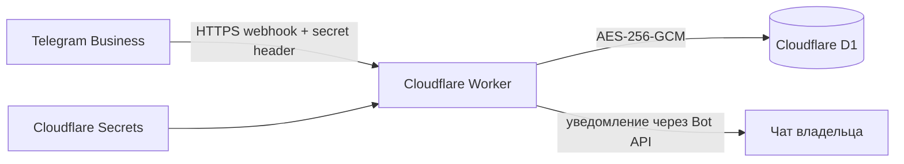

# Telegram Business Watcher

Личный Telegram Business-бот для отслеживания изменений и удалений входящих сообщений. Работает на Cloudflare Workers, хранит состояние в D1 и шифрует чувствительные поля перед записью в базу.

> [!IMPORTANT]
> Используйте проект только в чатах, к которым у вас есть законный доступ, и соблюдайте применимые правила конфиденциальности. Бот намеренно не копирует защищённые, платные и обнаруженные автоудаляемые сообщения.

## Что умеет бот

- запоминает новые входящие сообщения из разрешённых личных чатов;
- присылает владельцу изменения в формате «было / стало»;
- при удалении отправляет сохранённый текст и, когда Telegram разрешает, обычное вложение по `file_id`;
- отличает входящие сообщения от исходящих;
- сохраняет состояние между перезапусками в Cloudflare D1;
- шифрует текст, имена, названия чатов и `file_id` через AES-256-GCM;
- проверяет секретный заголовок Telegram webhook;
- очищает текст и `file_id` после успешной обработки удалённого сообщения;
- не требует постоянно включённого компьютера или отдельного VPS.

## Архитектура



Worker принимает только нужные типы обновлений, обрабатывает их последовательно и хранит минимально необходимое состояние в D1.

## Быстрый старт

Требования:

- Node.js 22 или новее;
- аккаунт Cloudflare;
- Telegram-бот, созданный через @BotFather;
- включённый у бота **Business Mode**;
- Git для клонирования репозитория.

```powershell
git clone https://github.com/<имя-пользователя>/telegram-business-watcher.git
cd telegram-business-watcher
npm ci
Copy-Item wrangler.example.jsonc wrangler.jsonc
npx wrangler login
```

Дальше создайте D1, настройте секреты, разверните Worker и зарегистрируйте webhook по подробной инструкции:

**[Развёртывание на Cloudflare](docs/CLOUDFLARE.md)**

Если PowerShell блокирует `npm.ps1` или `npx.ps1`, используйте `npm.cmd` и `npx.cmd`.

## Безопасность данных

В D1 шифруются:

- текст сообщения или подпись к медиа;
- отображаемое имя отправителя;
- название чата;
- Telegram `file_id` вложения.

Каждое непустое значение получает отдельный случайный nonce. AES-GCM дополнительно привязывает ciphertext к идентификатору записи и названию поля, поэтому перестановка зашифрованных значений между сообщениями не проходит проверку целостности.

Служебные идентификаторы, даты и флаги остаются открытыми: они нужны Worker для поиска, дедупликации и обработки обновлений. Это прикладное шифрование хранилища, а не сквозное шифрование Telegram. Worker получает разрешённые Telegram Business-сообщения и имеет доступ к ключу во время обработки.

> [!CAUTION]
> Не добавляйте `BOT_TOKEN`, `WEBHOOK_SECRET`, `SETUP_SECRET` или `ENCRYPTION_KEY` в Git. Не заменяйте `ENCRYPTION_KEY` без процедуры ротации: потеря прежнего ключа делает существующие зашифрованные записи нечитаемыми.

Подробнее о сообщении об уязвимостях: [SECURITY.md](SECURITY.md).

## HTTP-маршруты

| Метод | Маршрут | Назначение | Защита |
| --- | --- | --- | --- |
| `GET` | `/` | Краткая проверка доступности | Нет |
| `GET` | `/health` | Health check без раскрытия конфигурации | Нет |
| `POST` | `/webhook` | Приём обновлений Telegram | `X-Telegram-Bot-Api-Secret-Token` |
| `POST` | `/setup` | Регистрация webhook | `Authorization: Bearer SETUP_SECRET` |
| `POST` | `/admin/status` | Состояние webhook, подключений и D1 | `Authorization: Bearer SETUP_SECRET` |
| `POST` | `/admin/encrypt` | Шифрование старых записей пакетами | `Authorization: Bearer SETUP_SECRET` |

## Команды проекта

| Команда | Назначение |
| --- | --- |
| `npm test` | Запустить тесты Node.js |
| `npm run check` | Проверить синтаксис исходников |
| `npm run dev` | Запустить локальный Worker |
| `npm run deploy` | Развернуть Worker |
| `npm run db:create` | Создать D1-базу |
| `npm run db:migrate:local` | Применить миграции к локальной D1 |
| `npm run db:migrate:remote` | Применить миграции к удалённой D1 |
| `npm run logs` | Смотреть поток логов Worker |

## Локальная разработка

1. Создайте локальный конфиг и файл секретов:

   ```powershell
   Copy-Item wrangler.example.jsonc wrangler.jsonc
   Copy-Item .dev.vars.example .dev.vars
   ```

2. В `wrangler.jsonc` укажите UUID тестовой D1-базы, а в `.dev.vars` — тестовые значения.

3. Запустите локальную базу и Worker:

   ```powershell
   npm run db:migrate:local
   npm run dev
   ```

Настоящий Telegram webhook требует публичного HTTPS-адреса. Полный сценарий Telegram следует проверять на развёрнутом Worker или через отдельный безопасный туннель.

## Обновление развёрнутого Worker

Перед обновлением сохраните рабочий `wrangler.jsonc` и `ENCRYPTION_KEY`.

```powershell
git pull
npm ci
npm run db:migrate:remote
npm test
npm run check
npm run deploy
```

Wrangler применяет только ещё не выполненные миграции. Обычное развёртывание не удаляет ранее сохранённые Cloudflare Secrets.

## Ограничения

- Бот видит только разрешённые Telegram Business личные чаты.
- Секретные чаты Business-ботам недоступны.
- Защищённые, платные и обнаруженные автоудаляемые сообщения не копируются.
- Если таймер автоудаления был включён до подключения бота и Telegram не прислал событие настройки, Worker может не знать о нём.
- Содержимое сообщений, полученных до запуска Worker, восстановить нельзя.
- Повторная отправка вложения зависит от того, принимает ли Telegram сохранённый `file_id`.
- Изменение или удаление `ENCRYPTION_KEY` без ротации нарушит чтение существующих записей.

## Структура проекта

```text
.
├── .github/                  # CI и шаблоны GitHub
├── docs/CLOUDFLARE.md        # подробное развёртывание
├── migrations/               # миграции Cloudflare D1
├── src/core.js               # извлечение содержимого и отчёты
├── src/crypto.js             # AES-256-GCM
├── src/index.js              # Worker, webhook и D1
├── test/                     # модульные и интеграционные тесты
├── .dev.vars.example         # безопасный шаблон локальных секретов
└── wrangler.example.jsonc    # публичный шаблон Cloudflare-конфига
```

`wrangler.jsonc`, `.dev.vars`, `.env`, `.wrangler/`, `data/` и `node_modules/` исключены из Git.

## Участие в разработке

Перед pull request выполните:

```powershell
npm ci
npm test
npm run check
```

Дополнительные правила находятся в [CONTRIBUTING.md](CONTRIBUTING.md).

## Официальная документация

- [Cloudflare Workers](https://developers.cloudflare.com/workers/)
- [Wrangler](https://developers.cloudflare.com/workers/wrangler/)
- [Cloudflare D1 migrations](https://developers.cloudflare.com/d1/reference/migrations/)
- [Cloudflare Workers Secrets](https://developers.cloudflare.com/workers/configuration/secrets/)
- [Telegram Bot API: setWebhook](https://core.telegram.org/bots/api#setwebhook)
- [Telegram connected business bots](https://core.telegram.org/api/bots/connected-business-bots)

## Лицензия

[MIT](LICENSE)
